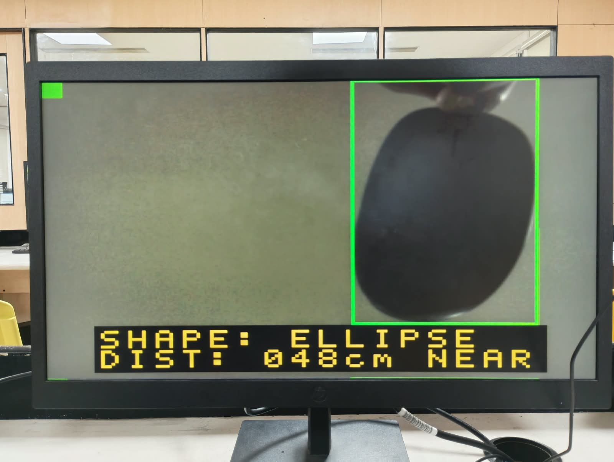
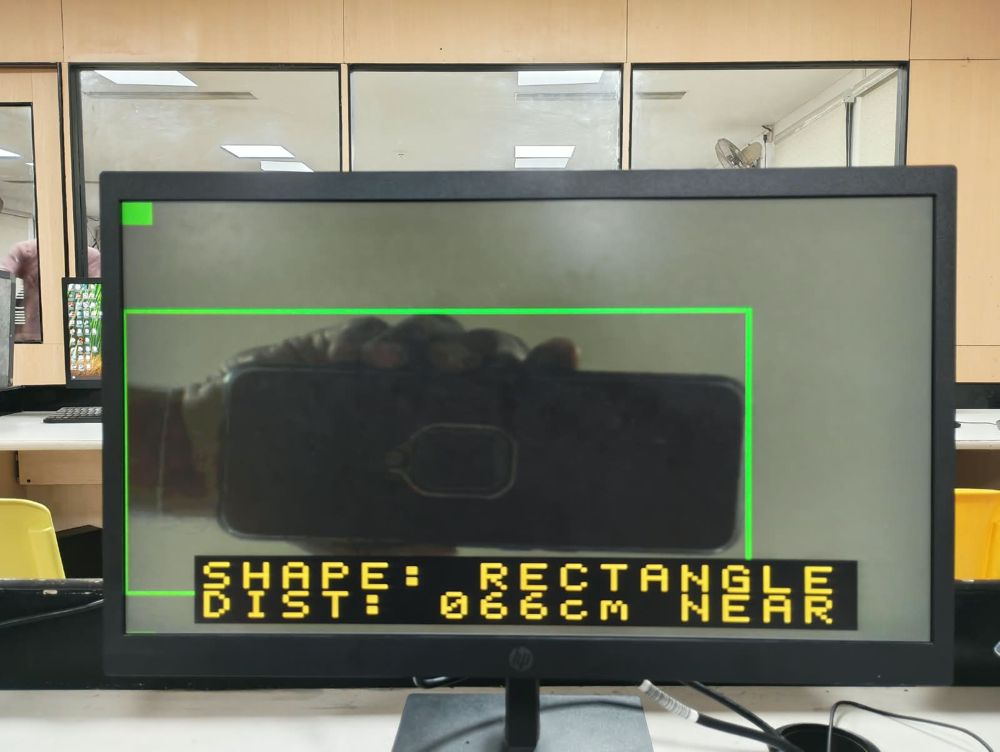
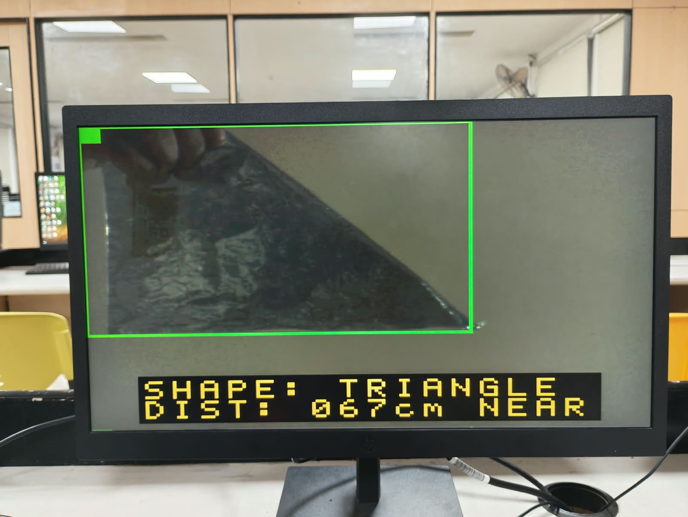
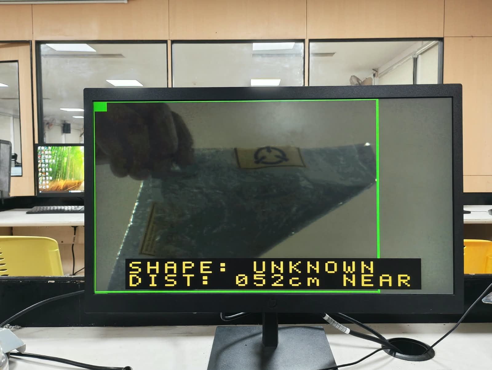
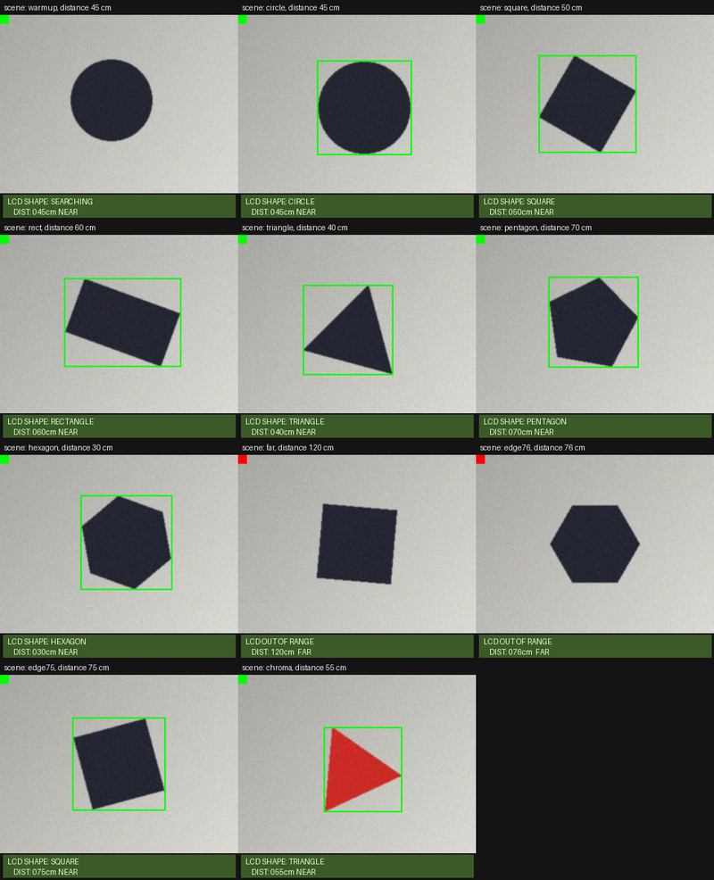

# DE2-115 Shape Recognition with Ultrasonic Distance Gating


A real-time vision system, written entirely in Verilog, that recognises simple
geometric shapes with a TRDB-D5M camera on a Terasic DE2-115 board. An HC-SR04
ultrasonic sensor acts as a gatekeeper: the design only looks at objects that
are **75 cm away or closer**. The live camera image goes to a VGA monitor with a
green bounding box, and the shape name and distance appear on the 16x2 LCD.

**Recognised classes:** circle, square, rectangle, triangle, pentagon, hexagon,
plus *ellipse* for an elongated round object and *unknown* for anything that
fits none of them.

> Developed as a course project for Digital System Design with FPGA at
> VIT Vellore (SENSE).


*Running on the DE2-115: the VGA monitor shows the camera image with the green bounding box, and the LCD overlay shows the shape and distance.*

---

## Contents

- [Highlights](#highlights)
- [System architecture](#system-architecture)
- [Repository layout](#repository-layout)
- [Quick start](#quick-start)
- [Controls and indicators](#controls-and-indicators)
- [How recognition works](#how-recognition-works)
- [Results on hardware](#results-on-hardware)
- [Verification](#verification)
- [Team](#team)
- [Acknowledgements](#acknowledgements)
- [License](#license)

## Highlights

* Pure RTL. There is no soft processor, no SDRAM controller and no PLL IP.
  All memory is on-chip (about 165 of 432 M9K blocks).
* **Adaptive threshold (ISODATA)** that follows lighting changes frame by frame.
* **Size-, position- and rotation-independent** shape features based on moment
  invariants and normalised width profiles.
* **Distance gate:** frames are processed only when the object is within
  75 cm, with a two-reading debounce on the sensor.
* A **bit-exact Python reference model** and a **full-system testbench** that
  compares every simulated frame against it.
* Tested on real hardware (DE2-115 + TRDB-D5M + HC-SR04).

## System architecture

```
 TRDB-D5M ──► d5m_capture ──► bayer_to_rgb ──┬──► frame buffer (M9K, 320x240 RGB555) ──► vga_display ──► VGA
 (GPIO)       640x480 Bayer   320x240 RGB    │                                              ▲  green box
                                             ▼                                              │
                                     pixel_segment (auto threshold)                          │
                                             ▼                                              │
                                 morph3x3 x4  (opening + closing)                            │
                                             ▼                                              │
                                     shape_analyzer ── class, box ── cdc_bus ───────────────┤
                                                                                            ▼
 HC-SR04 ──► ultrasonic_hcsr04 ── distance, near (<=75 cm) ─────────────► gate      lcd_text ► lcd_hd44780 ► LCD
 (EX_IO)

 d5m_i2c_config ──► camera registers (I2C)
```

## Repository layout

```
.
├── rtl/        Verilog source for every block
├── quartus/    Quartus Prime project, settings and timing constraints
├── model/      Bit-exact Python reference model + template generator
├── sim/        System testbench, synthetic camera scenes, results checker
├── docs/       Hardware setup guide and images
├── LICENSE
└── requirements.txt
```

| File | Block |
|---|---|
| `rtl/de2_115_shape_detect.v` | **Top level**: pin mapping, clocks/resets, all instances |
| `rtl/d5m_i2c_config.v` | Camera set-up: MT9P001 registers over I2C (640x480, binning, exposure) |
| `rtl/d5m_capture.v` | Camera capture: FVAL/LVAL/D, pixel coordinates, frame pulses |
| `rtl/bayer_to_rgb.v` | 2x2 Bayer quad to RGB, 640x480 to 320x240 |
| `rtl/pixel_segment.v` | Feature (dark / bright / chroma), adaptive ISODATA threshold, distance gate |
| `rtl/morph3x3.v` | Streaming 3x3 erosion / dilation for noise removal |
| `rtl/shape_analyzer.v` | Area, bounding box, moments, profiles, classifier, 2-frame debounce |
| `rtl/shape_templates.vh` | Template ROM and thresholds (generated by `model/gen_templates.py`) |
| `rtl/seq_divider.v` | Sequential divider for the threshold and classifier |
| `rtl/ultrasonic_hcsr04.v` | HC-SR04 driver, distance in cm, debounced 75 cm gate |
| `rtl/lcd_hd44780.v`, `rtl/lcd_text.v` | LCD controller and text formatting |
| `rtl/vga_display.v` | 640x480 @ 60 Hz timing, 2x upscaling, bounding-box overlay |
| `rtl/dual_clock_ram.v` | Dual-clock frame-buffer RAM |
| `rtl/cdc_bus.v` | Clock-domain crossing (toggle handshake, synchronisers, reset sync) |
| `rtl/hex7seg.v`, `rtl/font5x7.vh` | 7-segment decoder and LCD font |

## Quick start

### Build and run on the board

1. Open `quartus/de2_115_shape_detect.qpf` in Quartus Prime (the project was
   created with 18.1; the device `EP4CE115F29C7` is preset).
2. Import the pin assignments: *Assignments → Import Assignments*, using
   `DE2_115_pin_assignments.csv` from the DE2-115 System CD. That file belongs
   to Terasic, so it is not included here. The port names match it.
3. Compile and program the board.
4. Wire the camera and sensor as described in
   [`docs/hardware-setup.md`](docs/hardware-setup.md).

### Run the simulation

You need [Icarus Verilog](https://steveicarus.github.io/iverilog/) and Python 3.

```bash
pip install -r requirements.txt

cd sim
python3 gen_frames.py                 # builds synthetic camera scenes
iverilog -g2005 -I../rtl -o tb.vvp -s tb_top tb_top.v ../rtl/*.v
vvp -n tb.vvp > sim.log
python3 check_results.py sim.log      # compares every frame with the Python model
```

## Controls and indicators

| Control | Function |
|---|---|
| `KEY[0]` | Reset |
| `SW[1:0]` | Segmentation: `00` dark shape on light background, `01` light on dark, `10` coloured shape (chroma) |
| `SW[2]` | `1` = manual threshold from `SW[10:3]`, `0` = automatic |
| `SW[11]` | Show the binary mask on VGA instead of the camera image |
| `SW[12]` | Bypass the distance gate (bench testing) |
| `SW[16:13]` | Exposure (shutter = 256 + 64 x SW row times) |

| Indicator | Meaning |
|---|---|
| LCD line 1 | `SHAPE: <name>`, `SHAPE: SEARCHING` or `OUT OF RANGE` |
| LCD line 2 | `DIST: 042cm NEAR` or `FAR` |
| HEX2..0 | Distance in cm |
| HEX5..4 | Threshold in use |
| HEX6 | Class code |
| `LEDG[0]` | Object within range |
| `LEDG[1]` | Object found |
| `LEDG[8]` / `LEDG[7]` | Camera configured / camera I2C error |
| `LEDR[8:0]` | One-hot class |
| `LEDR[17]` | Toggles once per analysed frame |
| VGA top-left square | Green when the gate is open, red when the object is beyond 75 cm |

## How recognition works

1. **Adaptive threshold.** Each frame, the threshold moves to the midpoint of
   the object and background means (ISODATA), so it tracks lighting changes. If
   the two populations are too close (no contrast), the frame is treated as
   empty instead of producing noise. Chroma mode separates coloured shapes from
   a white or grey background independently of brightness.
2. **Morphological opening and closing** remove specks and fill pin-holes.
3. **Shape features that ignore size, position and rotation.** The affine
   moment invariant I1 = (μ20·μ02 − μ11²) / μ00⁴ takes a fixed value for every
   triangle (0.0093), every rectangle including squares (0.0069) and every
   ellipse including circles (0.0063), whatever the size, rotation or aspect
   ratio. Square vs rectangle and circle vs ellipse are separated by the
   rotation-invariant elongation of the second moments. Circle, pentagon and
   hexagon (I1 all close to 0.0064) are separated by matching normalised
   row/column width profiles against templates stored at several rotations,
   combined with their I1 difference.
4. **Temporal debounce.** The displayed class changes only when two consecutive
   frames agree.
5. **Distance gate.** A frame is processed only if the ultrasonic distance was
   ≤ 75 cm (two agreeing readings) when the frame started. Otherwise the mask
   is forced empty, no box is drawn and the LCD shows `OUT OF RANGE`.

In the Python model, accuracy was about 99 % over random sizes (roughly
45–145 px across), arbitrary rotation and segmentation noise.

## Results on hardware

Photos of the VGA output from the real board. Each shows the camera image, the
green bounding box, and the shape and distance reported on the LCD. The small
green square in the top-left corner means the distance gate is open (object
within 75 cm).

| Rectangle | Triangle |
|:---:|:---:|
|  |  |
| A hand-held rectangular object, **RECTANGLE** at 66 cm | A triangular object, **TRIANGLE** at 67 cm |

| Ellipse | Unknown |
|:---:|:---:|
|  |  |
| A dark oval object, **ELLIPSE** at 48 cm | An irregular object that fits no class, reported as **UNKNOWN** at 52 cm |

The *unknown* result is intentional: when an object does not match any template,
the design reports UNKNOWN instead of forcing a wrong guess.

The simulated VGA frames from the testbench are shown below in the
[Verification](#verification) section.

## Verification

**Simulation.** `sim/tb_top.v` simulates the complete top level, with models of
the camera (a Bayer stream built from synthetic scenes), its I2C interface, the
HC-SR04, the LCD and a VGA frame grabber. `sim/check_results.py` recomputes
every frame with the bit-exact Python model and compares class, bounding box
and area.


*Simulated VGA output from the full-system testbench (one frame per scene).*

The included run (`sim/sim.log`) covers 36 frames over 11 scenes, and every
frame matches the model bit for bit. Circle, rotated square, rotated rectangle,
triangle, pentagon, hexagon and a red triangle in chroma mode are all
recognised. A distance of 75 cm passes the gate, while 76 cm and 120 cm show
`OUT OF RANGE` with no box. The RTL also lints clean with Verilator `-Wall`,
apart from harmless zero-extension and unused-bit warnings.

**Hardware.** The design has been run on a DE2-115 with a TRDB-D5M camera and an
HC-SR04 sensor. On the board, the gate reacts within about two sensor periods
(~120 ms) plus one camera frame. Bayer phase, mirroring, exposure and the
camera pin mapping may need small adjustments for a different D5M revision; see
the troubleshooting list in [`docs/hardware-setup.md`](docs/hardware-setup.md).

## Team

| Name | Role | Main contributions | GitHub |
|---|---|---|---|
| Mohammed Naeem P A | Sensing, display and verification | `ultrasonic_hcsr04`, `lcd_hd44780`, `lcd_text`, `vga_display`, `hex7seg`, testbench in `sim/`, hardware testing and documentation | [MohmdNaeem](https://github.com/MohmdNaeem) |
| Albin Saji | Shape classifier and system integration | `shape_analyzer`, `shape_templates.vh`, Python reference model (`model/`), top level, clock-domain crossing and Quartus project | 
| Jovin Sebastian | Camera interface and image processing | `d5m_i2c_config`, `d5m_capture`, `bayer_to_rgb`, `pixel_segment`, `morph3x3`, `seq_divider` |

M.Tech VLSI Design, School of Electronics Engineering (SENSE), VIT Vellore.
Guided by Dr. Jagannadha K. Naidu.

## Acknowledgements

* Terasic, for the DE2-115 and TRDB-D5M documentation and reference designs
  that the camera pin mapping follows.
* The open-source tools used here: Icarus Verilog, Verilator, NumPy and SciPy.

## License

Released under the [MIT License](LICENSE). Contributions and forks are welcome.
